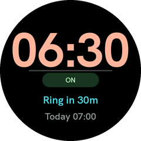
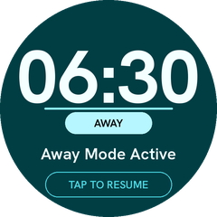
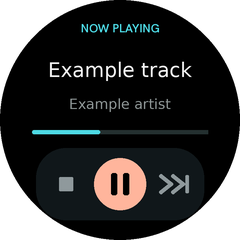

# AlarmV1 — ESPHome Alarm Clock for Home Assistant

An **ESP32-S3 smart alarm clock for the M5Stack Dial**, built with **ESPHome, LVGL and Home Assistant**. Its round touchscreen and rotary encoder put weekday/weekend scheduling, one-time alarms and snooze at your bedside. Use the local buzzer, or add Home Assistant speaker audio, morning briefings and music controls.

This is the **gurgendav fork**: the focus is AlarmV1's scheduling, digital interface and wake-up workflow—not the original analogue-clock demo.

> **Choose the right branch.** [`main`](https://github.com/gurgendav/esp-alarm-clock/tree/main) still contains the earlier analogue firmware. The digital AlarmV1 interface and features below live on [`wip/alarm-clock`](https://github.com/gurgendav/esp-alarm-clock/tree/wip/alarm-clock). Use that branch for the setup instructions. This README describes [firmware revision `6a3e0df`](https://github.com/gurgendav/esp-alarm-clock/commit/6a3e0df); it is not a release or a claim that those changes have been merged into `main`.

**Explore:** [Interface](#a-look-at-the-interface) · [Features](#what-alarmv1-does) · [Controls](#bedside-controls) · [Hardware](#hardware) · [Setup](#set-up-your-own) · [Home Assistant integration](#home-assistant-integration-contract) · [Reliability](#reliability-boundaries) · [Code](#find-your-way-around-the-code)

## A look at the interface

| Clock & next wake-up | Away mode | Music controls |
| :---: | :---: | :---: |
|  |  |  |

**These are source-derived UI previews, not on-device screenshots.** They use the firmware's fonts, colors, widget dimensions and example values, with a round mask to match the display. Text rasterization can differ from LVGL. No personal listening history or live household data is included. [Visual provenance and reproduction](docs/images/README.md).

The digital interface uses a large 24-hour clock, peach time text, cyan/teal state accents and compact next-ring information. There is no persistent bottom navigation: Home, alarm, briefing and music controls appear when needed. Media titles use DejaVu Sans for broader glyph coverage; the clock uses Hanken Grotesk. There is no runtime album art.

## What AlarmV1 does

### A routine, with room for one different morning

- **Weekday and weekend schedules** are stored on the device and exposed as Home Assistant time controls. Initial defaults are 07:00 and 09:00.
- **One-time alarm** changes only the next ring, not the recurring schedule. Set it with the dial, the Home Assistant `One-Time Alarm` picker, or the native API action. A chosen time means its next occurrence: today if still ahead, otherwise tomorrow. `Clear One-Time Alarm` restores the normal schedule; an override is also consumed when it rings.
- **Skip the next occurrence** without disabling the whole routine. If a one-time override is active, skipping removes that override and restores the regular next ring instead.
- **Away Mode** disables alarms and makes that state unmistakable with a full-screen teal background. Tap to resume.
- **Next Alarm Time** is exported as a timestamp for Home Assistant dashboards and automations.

### Ring, snooze, dismiss

- The **local buzzer** starts the alarm. Optional Home Assistant speaker audio takes over only after the configured speaker is observed as `playing`—an accepted action alone is not treated as playback. If playback is lost during ringing, the local buzzer resumes.
- The ringing screen provides **Snooze** and **hold-to-stop** controls. Stopping requires a 3-second hold with visible progress, reducing accidental dismissal.
- Touch snooze uses the selected duration; a short hardware-button press uses 5 minutes. The dial adjusts snooze duration from 5–60 minutes while ringing, or the active snooze target while snoozed.
- A wake session has a **two-snooze budget by default** (`snooze_budget`). Once exhausted, another snooze is refused; hold Stop to dismiss. An unanswered ring attempt times out after 5 minutes.
- Enabled state, recurring times, skip target and one-time override are persisted. **An active ringing/snooze session is not restored after reboot.**

### Home Assistant extras

- **Morning prompt:** after dismissal, choose `Briefing`, `Brief+Music` or `Dismiss`. Briefing automatically starts after about 15 seconds unless dismissed. The content comes from your own Home Assistant script, not from the firmware.
- **Home menu:** a temporary overlay with `All Off` and state-aware Start/Open/Resume Music actions; it closes after 10 seconds.
- **Media controller:** scrolling track title, artist, horizontal track progress, play/pause, stop/cancel and next track. Turning the dial changes volume in 5% steps and briefly shows a volume arc. Double-tap Next requests another playlist from your script. Long-press media Stop to cycle a sleep timer: off → 15 → 30 → 60 minutes.
- **Parents Home Mode:** mirrors the global Home Assistant helper `input_boolean.parents_home_mode`. Enabling it clears skip/override state, blocks schedule edits and Home-menu access, and suppresses post-dismiss briefing/music prompts while retaining alarm dismissal.
- **Readiness and history hooks:** the clock consumes external readiness/heartbeat sensors, shows `CHECK` when readiness is missing or stale, and exposes snooze counts, last event and last outcome. The external readiness checker and a complete Home Assistant automation package are **not included** in this repository.
- **Night-friendly display:** dims after about 60 seconds; nighttime brightness is reduced. At night, the first touch on a dimmed screen wakes the display rather than activating the underlying control.

## Bedside controls

These are the digital branch's normal-mode controls. Parents Home Mode intentionally blocks editing and menu access.

| Context | Turn the dial | Short hardware-button press | Hold hardware button for 3 seconds |
| --- | --- | --- | --- |
| Normal clock | Adjust the next ring as a one-time override | Open/close Home menu | Run configured All Off action |
| Alarm ringing | Adjust touch-snooze duration, 5–60 min | Snooze 5 min, if budget remains | Dismiss alarm |
| Snoozed | Adjust the active snooze-until time | Open/close Home menu | Dismiss snooze/alarm |
| Music screen | Change volume by 5% | Play/pause | Close screen and stop/cancel music |

**Touch:** tap the center to skip/unskip the next ring; while snoozed, this cancels the active snooze. In Away Mode, tap to re-enable alarms. Long-press the center to open Home. While ringing, tap Snooze or hold the on-screen Stop for 3 seconds.

**Dial acceleration:** slow/fast/very fast turns change the time by 1/5/15 minutes. Clockwise moves later from the current next ring. On the first anticlockwise turn, if the next scheduled ring is more than 3 hours away and there is no override, the clock offers a quick alarm about 30 minutes from now; subsequent turns fine-tune it. Dial edits are ignored while a ring is skipped.

## Hardware

The target is the [M5Stack Dial](https://docs.m5stack.com/en/core/M5Dial), an ESP32-S3-based unit with the following integrated parts. No external speaker is required for the local buzzer; network music needs a separate Home Assistant media player.

| Part | Firmware configuration |
| --- | --- |
| Round 240 × 240 display | GC9A01A, `mipi_spi`; MOSI GPIO5, CLK GPIO6, CS GPIO7, reset GPIO8, DC GPIO4 |
| Touchscreen | FT5x06, I²C address `0x38`, interrupt GPIO14 |
| Rotary encoder / front button | GPIO40 + GPIO41 / GPIO42 |
| RTC | PCF8563, I²C address `0x51` |
| Buzzer / backlight | GPIO3 / GPIO9 |
| Internal I²C | SDA GPIO11, SCL GPIO12 |
| NFC reader | RC522 at `0x28`; configured, but no user-facing NFC workflow is implemented |

Use a suitable power supply and USB-C data cable for initial flashing. These pins are for the Dial, not a generic ESP32 wiring guide.

<details>
<summary>Enclosure inspiration and original hardware photo</summary>


The existing repository photo shows the original analogue interface and an optional printed enclosure, **not** the digital AlarmV1 UI above. The original project's [printable enclosure](https://www.printables.com/model/1562621-analogue-alarm-clock-for-home-assistant) is a starting point; check fit for your hardware.

</details>

## Set up your own

### 1. Get the digital firmware and ESPHome

Use [ESPHome](https://esphome.io/guides/getting_started_command_line/) with ESP-IDF support. The config declares **ESPHome 2025.11.0 minimum**; that minimum is not a guarantee that every later ESPHome release builds unchanged. There is no prebuilt firmware release or pinned build environment here.

```sh
git clone --branch wip/alarm-clock https://github.com/gurgendav/esp-alarm-clock.git
cd esp-alarm-clock
```

Keep the checkout intact: `clock.yaml` needs both root support headers and the fonts in `assets/`. Do not copy only the YAML into an ESPHome dashboard directory.

For a local CLI installation, create a virtual environment and install ESPHome (plus pytest for the host tests):

```sh
python3 -m venv .venv
. .venv/bin/activate
python -m pip install esphome pytest
```

The local `.venv/` is not firmware; never commit it or your credentials.

### 2. Configure credentials, time zone and integrations

Create a **local, untracked** `secrets.yaml` beside `clock.yaml`:

```yaml
wifi_ssid: "YOUR_WIFI_NAME"
wifi_password: "YOUR_WIFI_PASSWORD"
```

Before compiling, review `clock.yaml`:

- Give `esphome.name` a unique generic device name; `friendly_name` is `AlarmV1`.
- Set `substitutions.timezone` to your IANA time zone. The checked-in default is `Etc/UTC`.
- Replace `media_player.example_speaker` with your actual player for both alarm audio and morning/media playback, or configure them separately.
- Implement the Home Assistant actions listed below before relying on those features.
- Review **All Off**: the default `light.turn_off` target is `all`. Narrow `home_lights_off_entity` if you do not want a long idle-button hold to turn off every light.
- Configure API/OTA authentication and web-server access for your network before deployment. The checked-in configuration does not provide those protections; do not expose the device to the internet.

### 3. Validate, compile and install

Run from the digital-branch checkout:

```sh
python -m pytest -q
esphome config clock.yaml
esphome compile clock.yaml
```

For the first installation, connect over USB and replace the example serial-port path with your own:

```sh
esphome upload clock.yaml --device /dev/ttyACM0
esphome logs clock.yaml --device /dev/ttyACM0
```

Later, after validating and compiling, OTA upload to the device's own address:

```sh
esphome upload clock.yaml --device YOUR_DEVICE_ADDRESS
```

These are installation instructions, not a request to flash an already-running clock. Host tests check code behavior/wiring; they do not establish physical buzzer volume, speaker audibility or offline battery operation.

### 4. Pair with Home Assistant and check the next ring

Add the device via the [ESPHome integration](https://www.home-assistant.io/integrations/esphome/). Allow the device to perform Home Assistant actions if you want speaker audio, briefing, media controls or All Off.

Set `Weekday Alarm Time` and `Weekend Alarm Time`; ensure `Alarm Enabled` is on. For a single different morning, use `One-Time Alarm` rather than editing the recurring schedule. Check the device's `Next Alarm Time` after every change. Entity IDs are assigned by your Home Assistant installation: the names below are labels, not guaranteed IDs.

| Device entities | Purpose |
| --- | --- |
| `Alarm Enabled`, `Weekday Alarm Time`, `Weekend Alarm Time` | Routine and Away Mode |
| `One-Time Alarm`, `Clear One-Time Alarm` | Temporary next-occurrence override |
| `Next Alarm Time`, `Alarm Ringing` | Dashboard/automation state |
| `Stop Alarm`, `Test Alarm` | Remote dismissal and an **audible** manual test |
| `Snoozes Used`, `Snoozes Remaining` | Current wake-session budget |
| `Last Alarm Event`, `Last Alarm Outcome` | Lifecycle/history integration |
| `Backlight`, `Button` | Display and physical-button entities |

Test deliberately while awake and ready for sound. Check local buzzer behavior with Home Assistant unavailable, snooze, dismissal and speaker handoff before trusting the clock for an important wake-up.

## Home Assistant integration contract

The firmware calls your Home Assistant actions; it does **not** ship the scripts, playlists, TTS configuration, readiness checker or Recorder setup. Music Assistant is one possible backend, not a requirement for the local alarm.

| Substitution / helper | Expected behavior |
| --- | --- |
| `alarm_audio_start_action` (default `script.alarmv1_start_alarm_audio`) | Receives `entity_id` from `alarm_audio_player_entity`; start alarm audio on that player. The firmware observes player state before silencing its buzzer. |
| `alarm_audio_stop_action` (default `media_player.media_stop`) | Receives the same `entity_id`; stop audio on snooze, dismissal, disable or timeout. |
| `morning_briefing_action` (default `script.alarmv1_morning_briefing`) | Accept `media_player_entity_id`; optional string flags `play_music_after: "true"`, `music_only: "true"`, `skip_playlist: "true"` select the requested flow. |
| `morning_briefing_player_entity` | Player whose state, metadata, position, duration and volume drive the music screen. |
| `home_lights_off_action` / `home_lights_off_entity` | All Off action and its `entity_id` argument. |
| `alarm_readiness_entity` / `alarm_readiness_heartbeat_entity` | External sensors: state `ready` plus an epoch-seconds heartbeat no more than 120 seconds old. Missing/stale values show `CHECK`; they do not disable the local schedule. |
| `input_boolean.parents_home_mode` | Optional HA-owned global read-only mode; this helper ID is currently literal in the firmware, not a substitution. |

For example, these are **firmware substitutions**, not a complete Home Assistant package:

```yaml
substitutions:
  timezone: Etc/UTC
  alarm_audio_player_entity: media_player.example_speaker
  alarm_audio_start_action: script.alarmv1_start_alarm_audio
  alarm_audio_stop_action: media_player.media_stop
  morning_briefing_action: script.alarmv1_morning_briefing
  morning_briefing_player_entity: media_player.example_speaker
  home_lights_off_action: light.turn_off
  home_lights_off_entity: light.example_bedside
  alarm_readiness_entity: sensor.example_alarm_readiness
  alarm_readiness_heartbeat_entity: sensor.example_alarm_readiness_heartbeat
  snooze_budget: "2"
```

Your briefing/music script should handle cancellation as well as start requests. Speaker `playing` is a reported state, not proof of audible sound; network players can buffer, fail or have their own volume/mute settings.

## Reliability boundaries

- Scheduling and the buzzer run locally **when the device has power and valid time**. SNTP writes time to the PCF8563 RTC; boot explicitly reads the RTC. Validate RTC retention and any backup-battery arrangement on your own unit. An RTC is not backup power for the display, processor or buzzer.
- Wi-Fi/API disconnect reboot timeouts are disabled in the digital branch, so a network outage alone should not continually restart the clock. External speaker audio, metadata, briefing and HA helpers still depend on Home Assistant/network availability.
- Persisted settings use a 10-second flash-write interval. Allow time after edits before disconnecting power. Ringing and active snooze are volatile.
- `CHECK` means external readiness has not been confirmed; `ON` is not an independent guarantee of sound or successful wake-up. This is a DIY project, not a certified safety-critical alarm.

## Find your way around the code

Links below intentionally target the **digital development branch**, because the default branch still holds the earlier implementation:

- [`clock.yaml`](https://github.com/gurgendav/esp-alarm-clock/blob/wip/alarm-clock/clock.yaml) — hardware, schedules, state machine, HA actions and LVGL UI.
- [`alarmv1_media_text.h`](https://github.com/gurgendav/esp-alarm-clock/blob/wip/alarm-clock/alarmv1_media_text.h) — media-text handling.
- [`alarmv1_screenshot.h`](https://github.com/gurgendav/esp-alarm-clock/blob/wip/alarm-clock/alarmv1_screenshot.h) — local display-capture/navigation handlers. Treat captures as potentially private; the endpoint shows what is currently on the device.
- [`assets/`](https://github.com/gurgendav/esp-alarm-clock/tree/wip/alarm-clock/assets) — UI fonts and Hanken Grotesk font license.
- [`tests/`](https://github.com/gurgendav/esp-alarm-clock/tree/wip/alarm-clock/tests) — UI/behavior checks, RTC boot-wiring checks and a host C++ harness for production audio paths; no substitute for hardware testing.
- [`debug.yaml`](debug.yaml) — separate diagnostic configuration; not required by `clock.yaml`.

## Credits

AlarmV1 builds on [tomwilkie/clock](https://github.com/tomwilkie/clock), the original M5Stack Dial analogue clock and enclosure project. This fork's scheduling, digital UI, wake-session behavior and Home Assistant/media workflow are documented above. ESPHome and LVGL provide the firmware and UI foundations.
